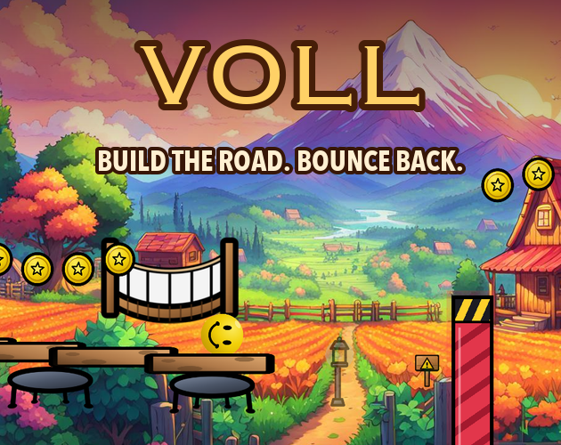

# VOLL

A smiley ball never stops rolling. Build trampolines, ramps and floors in real time to keep it alive.
Made in Godot 4 for the **"Bounce Back"** game jam.



## Play

- **Browser:** upload `itch/upload/voll_web.zip` to itch.io (see [itch/ITCH_PAGE.md](itch/ITCH_PAGE.md)).
- **From source:** open `godot/project.godot` in Godot 4.7 and press Play.

## Controls

| Action | Key |
|---|---|
| Aim | Mouse |
| Place piece | Left click |
| Pick piece | 1 Trampoline · 2 Ramp · 3 Floor |
| Flip ramp | R |
| Pause | Esc / P |
| Restart / continue from checkpoint | Space |

**Versus, player 2:** arrows aim · Enter places · `,` `.` `/` pick a piece · `'` flips the ramp
(gamepad: left stick · A place · X cycle · Y flip)

## Features

- Endless course: three hand-made warm-up levels, then random levels that get harder every 60 m
- Checkpoints between levels: continue from the last flag after a crash
- 3 hearts, shields, slow-mo hourglasses, speed boosters, rest bridges and coins
- Clutch bounces and enemy stomps build a combo for bonus metres
- 12 ball varieties unlocked through 11 awards; coin shop with permanent upgrades
- 2-player split-screen versus, or versus the computer (Easy / Normal / Hard)
- Stats & awards page, high-contrast hazards and reduce-motion options

## Project layout

```
godot/      the game (Godot 4.7 project)
itch/       itch.io kit: page text, cover, screenshots, trailer, upload folder
assets/     original art sheets
Voll.json   the earlier GDevelop prototype (kept for reference)
```

Run the tests from the repo root:

```bash
/Users/sparsh/Downloads/Godot.app/Contents/MacOS/Godot --headless --path godot --fixed-fps 60 -s res://tests/run_tests.gd
```

## Credits

- **Game design, code and levels:** the Voll team
- **Music:** Voll background theme, written and sung by the Voll team
- **Art:** character, prop and UI art by the Voll team. Some images were found online through Google Images;
  they belong to their original artists and are used for a non-commercial jam entry.
- **Sound effects:** synthesised in-engine
- **Menus:** [Maaack's Godot Menus Template](https://github.com/Maaack/Godot-Menus-Template) (MIT)
- **Engine:** [Godot Engine](https://godotengine.org) (MIT)

## Art resources and free alternatives

Free assets that look like VOLL's art. Use them to replace the images found online, or as references.
Licences are as listed on each page in November 2026; check the page before using an asset.
(CC0 = public domain, no credit required. CC BY = credit the artist.)

### Smiley balls and faces

- [Rhos Vector Emojis](https://rhosgfx.itch.io/vector-emojis) (CC0)
- [49Wolf Smileys Pack 1](https://49wolf.itch.io/smileys-pack-1) (CC0)
- [49Wolf Smileys Pack 2](https://49wolf.itch.io/smileys-pack-2) (CC0)
- [kuteken Pixel Art Emoji](https://kuteken.itch.io/pixel-art-emoji) (CC0)
- [110 Free Pixelmojis](https://gabl18.itch.io/110-free-pixelmojis) (CC0)
- [actuallyKron Free Emoji Pack](https://actuallykron.itch.io/free-emoji-pack) (CC0)
- [Pixymoji](https://spicygame.itch.io/pixymoji) (CC0)
- [Simply Expressive](https://splendiddog.itch.io/simply-expressive) (CC0)
- [100 smiley faces](https://opengameart.org/content/100-smiley-faces) (CC0)
- [Mini Daemon](https://opengameart.org/content/mini-daemon) (check page)
- [Icy Tower demon sprites](https://opengameart.org/content/icy-tower-demon-sprites) (CC0)
- [OpenMoji](https://openmoji.org/faq) (CC BY-SA 4.0)
- [OpenGameArt emoji collection](https://opengameart.org/content/emojis)

### Trampoline, ramp, floor, spikes, coins

- [Kenney Platformer Pack Redux](https://kenney.nl/assets/platformer-pack-redux) (CC0)
- [Kenney New Platformer Pack](https://kenney.nl/assets/new-platformer-pack) (CC0)
- [Kenney Jumper Pack](https://kenney.nl/assets/jumper-pack) (CC0)
- [Kenney Platformer Art Deluxe](https://kenney.nl/assets/platformer-art-deluxe) (CC0)
- [Cartoon 16×16 Platformer Pack](https://doughnutdev.itch.io/platformer-assetpack) (not CC0, check page)

### Keycaps and control prompts

- [Mr. Breakfast's Free Prompts](https://mrbreakfastsdelight.itch.io/mr-breakfasts-free-prompts) (CC0)
- [Kenney Input Prompts](https://kenney-assets.itch.io/input-prompts) (check page)
- [Kenney Input Prompts Pixel 16×](https://opengameart.org/content/input-prompts-pixel-16%C3%97) (CC0)
- [DevMajoris Input Icons Pack](https://devmajoris.itch.io/input-icons-pack) (CC0)
- [vegaboo Game Prompts](https://vegaboo.itch.io/game-prompts) (CC0)
- [PrototypeGames 16×16 Input Prompts](https://prototypegames.itch.io/16x16-input-prompts) (CC0)
- [Simple Keyboard Input Prompts](https://pixel-3d-x.itch.io/simple-keyboard-input-prompts) (CC0)

### Level backgrounds

- [Free Mountain Peak Pixel Art Backgrounds](https://free-game-assets.itch.io/free-mountain-peak-pixel-art-backgrounds) (check page)
- [4 Free Seamless Nature Pixel Backgrounds](https://free-game-assets.itch.io/4-free-seamless-nature-pixel-backgrounds) (check page)
- [Nature Landscapes Free Pixel Art](https://free-game-assets.itch.io/nature-landscapes-free-pixel-art) (check page)
- [Free Cartoon Forest 2D Backgrounds](https://free-game-assets.itch.io/free-cartoon-forest-2d-backgrounds) (check page)
- [Free Fairy-Tale 2D Backgrounds](https://free-game-assets.itch.io/free-fairy-tale-2d-backgrounds) (check page)
- [Pixel Art Mountains Parallax](https://dustdfg.itch.io/pixel-art-mountains-parallax) (CC0)
- [Free Pixel Art Mountains Tileset and Backgrounds](https://karsiori.itch.io/free-pixel-art-mountains-tileset-and-backgrounds) (check page)
- [Free Pixel Art Woods Tileset and Background](https://karsiori.itch.io/woods-tileset-and-background) (CC0)
- [Scenery: The Woods](https://opengameart.org/content/scenery-the-woods) (CC0)
- ["House On The Mountains" background](https://pixel-1992.itch.io/free-pixel-art-house-on-the-mountains) (check page)
- ["Deep Forest" side-scroller background](https://pixel-1992.itch.io/free-pixel-art-side-scroller) (check page)
- [Free 2D Cartoon Forest Backgrounds (TBWorks)](https://tbworks.itch.io/free-2d-cartoon-forest-backgrounds-for-platformer-games-png-psd-assets-royalty-f) (no attribution required)
- [Large-scale Pixel Cottage pack](https://studiodenny.itch.io/large-scale-pixel-forest-asset-pack) (custom licence: OK in games, no reselling)
- [Pine Hills Background](https://myaumya.itch.io/pine-hills-background) (check page)
- [Parallax Mountain Background](https://bearbreath.itch.io/parallax-mountain-background) (check page)

### Browse more

- [itch.io CC0 sprites](https://itch.io/game-assets/tag-cc0/tag-sprites)
- [itch.io CC0 pixel art](https://itch.io/game-assets/tag-cc0/tag-pixel-art)
- [Kenney assets (all CC0)](https://kenney.nl/assets)

To find who made an image you got from Google, use a reverse image search ([Google Lens](https://lens.google.com) or
[TinEye](https://tineye.com)), then credit the artist above and in the in-game credits.
